# customer-mask

A [Claude Code mod](https://claude.com/resources/articles/claude-code-mods) that keeps customer data out of what Claude sees.

```mermaid
flowchart LR
    you["You<br/>files · commands · prompts"]
    mask["mask<br/>real → placeholder"]
    model["Claude<br/>(Anthropic API)"]
    unmask["unmask<br/>placeholder → real"]
    out["Your screen<br/>Your tools &amp; files"]

    you -- "Acme Freight A/S" --> mask
    mask -- "&lt;&lt;CUSTOMER_1&gt;&gt;" --> model
    model -- "&lt;&lt;CUSTOMER_1&gt;&gt;" --> unmask
    unmask -- "Acme Freight A/S" --> out

    classDef safe fill:#e8f5e9,stroke:#2e7d32,color:#1b5e20
    classDef cloud fill:#fff3e0,stroke:#ef6c00,color:#e65100
    class mask,unmask safe
    class model cloud
```

Customer names, emails, phone numbers, IBANs, CPR numbers and your own IDs are replaced with placeholders such as `<<CUSTOMER_1>>` **before** anything is sent to the model. They are put back **after**: in the reply you read, and in the commands and file edits Claude makes (tools that send data off your machine, such as web search and MCP tools, keep the placeholders). Claude reasons about `<<CUSTOMER_1>>`. You and your tools see `Acme Freight A/S`.



## What it looks like

| | Text |
| --- | --- |
| A row in `shipments.csv` | `Acme Freight A/S,SHP12345678,ops@acme-freight.dk` |
| What Claude receives | `<<CUSTOMER_1.k3f9>>,<<SHIPMENT_1.k3f9>>,<<EMAIL_1.k3f9>>` |
| Claude's reply, as Claude wrote it | `The customer is <<CUSTOMER_1.k3f9>> and the shipment id is <<SHIPMENT_1.k3f9>> …` |
| The reply as it streams to you | `The customer is Acme Freight A/S and the shipment id is SHP12345678 …` |
| The command Claude asked for | `echo "<<CUSTOMER_1.k3f9>> / <<SHIPMENT_1.k3f9>>" > out.txt` |
| What actually ran, and what's in `out.txt` | `Acme Freight A/S / SHP12345678` |

The values and the flow are from real runs ([verification](docs/development.md#what-has-been-verified)). `k3f9` stands for the random marker each session picks, and the numbers depend on what the session saw first. Diagrams leave the marker out for brevity.

## Quick start

**1. Install.** It needs Claude Code 2.1.296 or newer. On 2.1.287 to 2.1.295 the mod blocks every request; before 2.1.287 Claude Code has no mods, so it doesn't run at all. At the Claude Code prompt:

```
/plugin install customer-mask --marketplace majidkabir/customer-mask
```

Answer `y` to add the marketplace, then pick a scope (user scope = every project). From a shell, the same is `claude plugin install customer-mask --marketplace majidkabir/customer-mask --scope user`.

Or run it from a clone for one session:

```bash
git clone https://github.com/majidkabir/customer-mask
claude --plugin-dir ./customer-mask
```

**2. Tell it your customers.** Create `.claude/customer-mask.json` in your project (or `~/.claude/customer-mask.json` for all projects):

```json
{
  "customers": ["Acme Freight A/S", "Nordic Widgets ApS"],
  "patterns": [{ "label": "SHIPMENT", "regex": "\\bSHP\\d{8}\\b" }]
}
```

Emails, phone numbers, IBANs and Danish CPR numbers are detected without any config. Full options are in [docs/configuration.md](docs/configuration.md).

> Never commit the real customer list. `.claude/customer-mask.json` is in this repo's `.gitignore`; add it to yours too.

**3. Check it.** Start a session and type:

```
/customer-mask
```

It shows the config it loaded and every value it has replaced so far. The status line shows `🔒 customer-mask on`. After editing the config, `/customer-mask reload` applies it without restarting.

## What is covered

| Data path | Masked? |
| --- | --- |
| Your prompts | ✅ |
| File contents Claude reads, command output, search results (all tool results) | ✅ |
| `CLAUDE.md` and other context Claude Code adds | ✅ |
| `@file` mentions and reminders Claude Code injects | ✅ |
| Parts of the system prompt that vary per session | ✅ |
| Subagents' conversations | ✅ |
| The session's files on disk (`~/.claude/projects/…`): transcript, subagent transcripts, saved full outputs | ✅ when the session ends. Claude Code writes some unmasked local copies during the session; the mod masks them when it ends. The placeholder table saved beside them holds the real values, so resumed sessions keep working |
| `claude -p` / SDK output | 🟡 masked; restore it with `… --output-format json \| node tools/unmask.mjs` |
| Arguments of `WebSearch`, `WebFetch` and every MCP tool (they can leave your machine) | ✅ kept masked; local MCP tools can be exempted |
| Automatic session title | ❌ in headless runs (`claude -p`, SDK) the raw first prompt goes to a small model to make the title; interactive sessions not yet checked ([open questions #1](docs/open-questions.md#1-headless-session-title-is-generated-from-the-raw-prompt)) |
| Images and PDFs | ✅ removed before sending; Claude is told why (configurable) |
| Spelling variants of listed customers (`Acme Freight`, `ACME FREIGHT ApS`, `acme-freight`) | ✅ |
| Customer names that are in neither your list nor a pattern | ❌ detection is list- and pattern-based |

If the mod itself fails, it fails closed. A broken config, an unreadable placeholder table or an unsupported Claude Code version **blocks** every request. Anything that can't be masked in time (a conversation row, a context block, part of the system prompt) is sent **with its text replaced by a note**, injected text is left out, and a tool call whose arguments can't be restored is denied. The ❌ rows above and the [open questions](docs/open-questions.md) are the known gaps.

## Documentation

- **[How it works](docs/how-it-works.md)**: diagrams of every data path, the placeholder vault, streaming, and fail-closed behaviour
- **[Configuration](docs/configuration.md)**: all options, examples, keeping the customer list up to date
- **[Team rollout](docs/team-rollout.md)**: run it for everyone with managed settings and one central customer list built from a CRM export
- **[Development](docs/development.md)**: repo layout, tests, debugging, what has been verified
- **[Open questions](docs/open-questions.md)**: known gaps and decisions still to make

## Status

Version 0.4.1, an early prototype. The Claude Code mods API is marked *early access* and may change between releases. Read [open questions](docs/open-questions.md) before you rely on this for regulated data.

## License

[MIT](LICENSE): free to use, copy, modify and distribute, including commercially, as long as the copyright notice is kept. Provided as is, without warranty.
