# customer-mask

A [Claude Code mod](https://claude.com/resources/articles/claude-code-mods) that keeps customer data out of what Claude sees.

```mermaid
flowchart LR
    you["You<br/>files · commands · prompts"]
    mask["mask<br/>real → placeholder"]
    model["Claude<br/>(Anthropic API)"]
    unmask["unmask<br/>placeholder → real"]
    out["Your screen<br/>Your tools &amp; files"]

    you -- "Acme Freight A/S" --> mask
    mask -- "&lt;&lt;CUSTOMER_1&gt;&gt;" --> model
    model -- "&lt;&lt;CUSTOMER_1&gt;&gt;" --> unmask
    unmask -- "Acme Freight A/S" --> out

    classDef safe fill:#e8f5e9,stroke:#2e7d32,color:#1b5e20
    classDef cloud fill:#fff3e0,stroke:#ef6c00,color:#e65100
    class mask,unmask safe
    class model cloud
```

Customer names, emails, phone numbers, IBANs, CPR numbers and your own IDs are replaced with placeholders such as `<<CUSTOMER_1>>` **before** anything is sent to the model. They are put back **after**: in the reply you read, and in the commands and file edits Claude makes. Claude reasons about `<<CUSTOMER_1>>`. You and your tools see `Acme Freight A/S`.



## What it looks like

| | Text |
| --- | --- |
| A row in `shipments.csv` | `Acme Freight A/S,SHP12345678,ops@acme-freight.dk` |
| What Claude receives | `<<CUSTOMER_1>>,<<SHIPMENT_1>>,<<EMAIL_n>>` |
| Claude's reply, as Claude wrote it | `The customer is <<CUSTOMER_1>>, shipment <<SHIPMENT_1>> …` |
| The reply on your screen | `The customer is Acme Freight A/S, shipment SHP12345678 …` |
| The command Claude asked for | `echo "<<CUSTOMER_1>> / <<SHIPMENT_1>>" > out.txt` |
| What actually ran, and what's in `out.txt` | `Acme Freight A/S / SHP12345678` |

These rows are from a real run, not a mock-up ([verification](docs/development.md#what-has-been-verified)).

## Quick start

**1. Install** (Claude Code v2.1.287 or newer). At the Claude Code prompt:

```
/plugin install customer-mask --marketplace majidkabir/customer-mask
```

Answer `y` to add the marketplace, then pick a scope (user scope = every project).

Or run it from a clone for one session:

```bash
git clone https://github.com/majidkabir/customer-mask
claude --plugin-dir ./customer-mask
```

**2. Tell it your customers.** Create `.claude/customer-mask.json` in your project (or `~/.claude/customer-mask.json` for all projects):

```json
{
  "customers": ["Acme Freight A/S", "Nordic Widgets ApS"],
  "patterns": [{ "label": "SHIPMENT", "regex": "\\bSHP\\d{8}\\b" }]
}
```

Emails, phone numbers, IBANs and Danish CPR numbers are detected without any config. Full options are in [docs/configuration.md](docs/configuration.md).

> Never commit the real customer list. `.claude/customer-mask.json` is in this repo's `.gitignore`; add it to yours too.

**3. Check it.** Start a session and type:

```
/customer-mask
```

It shows the config it loaded and every value it has replaced so far. The status line shows `🔒 customer-mask on`.

## What is covered

| Data path | Masked? |
| --- | --- |
| Your prompts | ✅ |
| File contents Claude reads, command output, search results (all tool results) | ✅ |
| `CLAUDE.md` and other context Claude Code adds | ✅ |
| `@file` mentions and reminders Claude Code injects | ✅ |
| Per-session parts of the system prompt (git branch, paths, …) | ✅ |
| Subagents' conversations | ✅ |
| The transcript saved on disk (`~/.claude/projects/…`) | ✅ placeholders only |
| Arguments of `WebSearch`, `WebFetch` and every MCP tool (they can leave your machine) | ✅ kept masked; local MCP tools can be exempted |
| Automatic session title in **headless** runs (`claude -p`, SDK) | ❌ see [open questions](docs/open-questions.md#1-headless-session-title-is-generated-from-the-raw-prompt) |
| Images and PDFs | ❌ text only |
| Customer names that are in neither your list nor a pattern | ❌ detection is list- and pattern-based |

If masking ever fails (a broken config, an exception), the mod **blocks** further requests in that session instead of sending unmasked data.

## Documentation

- **[How it works](docs/how-it-works.md)**: diagrams of every data path, the placeholder vault, streaming, and fail-closed behaviour
- **[Configuration](docs/configuration.md)**: all options, examples, keeping the customer list up to date
- **[Development](docs/development.md)**: repo layout, tests, debugging, what has been verified
- **[Open questions](docs/open-questions.md)**: known gaps and decisions still to make

## Status

Version 0.1, an early prototype. The Claude Code mods API is marked *early access* and may change between releases. Read [open questions](docs/open-questions.md) before you rely on this for regulated data.
