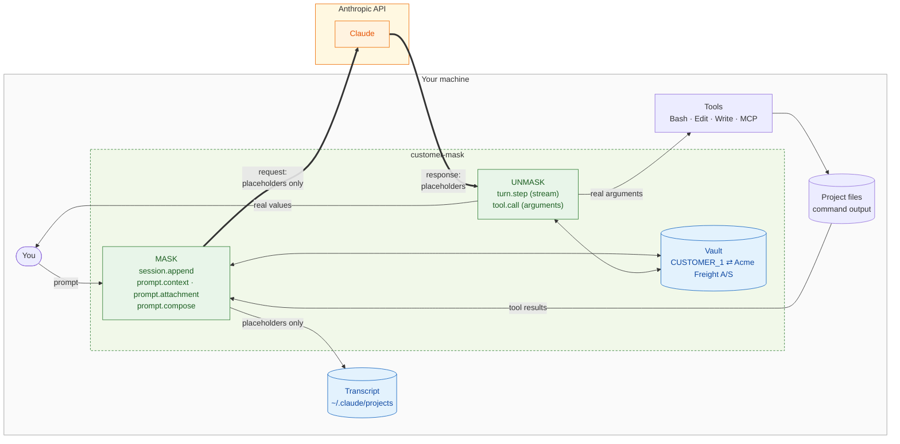
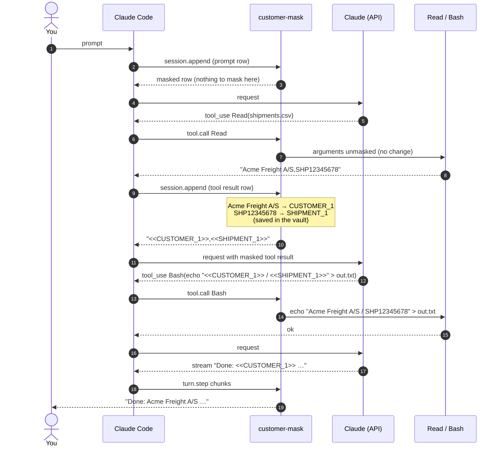
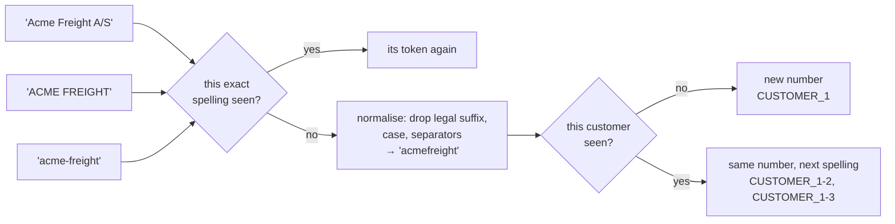
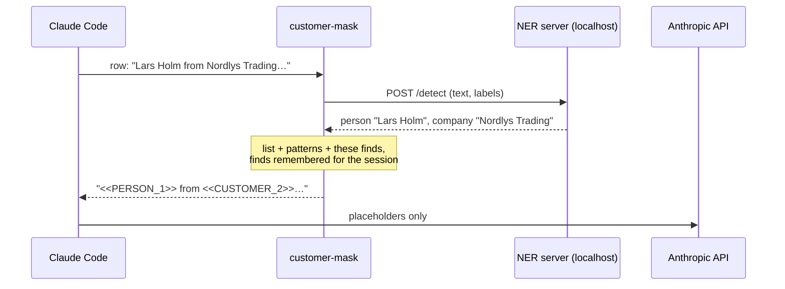
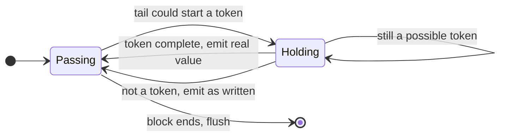
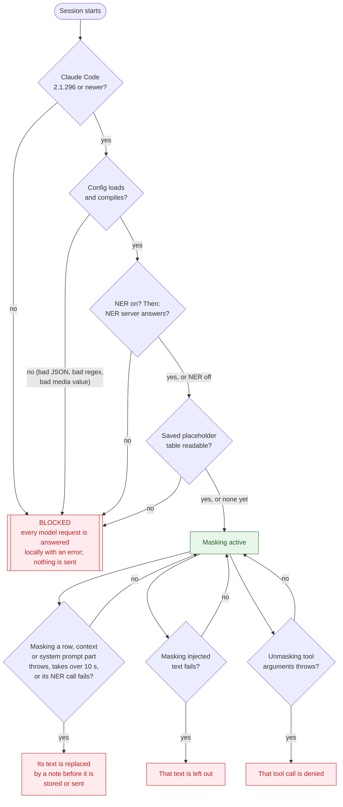

# How it works

customer-mask is a Claude Code **mod**: TypeScript functions that run inside the Claude Code process and hook the events Claude Code raises. It needs no proxy and no network setup. It sits in the path of every row that enters the conversation and every response that comes back.

- [1. The big picture](#1-the-big-picture)
- [2. One round trip, step by step](#2-one-round-trip-step-by-step)
- [3. The hooks](#3-the-hooks)
- [4. The placeholder vault](#4-the-placeholder-vault)
- [5. Detection](#5-detection)
- [6. Unmasking a stream](#6-unmasking-a-stream)
- [7. Failing closed](#7-failing-closed)
- [8. What you see on screen](#8-what-you-see-on-screen)

## 1. The big picture

Everything inside **Your machine** stays there. Only placeholders cross the thick arrows to the Anthropic API, apart from the known gaps in [open questions](open-questions.md) (notably the headless session title, #1).



There are two directions:

- **Into the conversation (mask):** anything that becomes part of what Claude reads has real values swapped for placeholders. That includes your prompt, a file Claude read, command output, `CLAUDE.md` and the parts of the system prompt that vary per session. Images and PDFs are removed.
- **Out of the model (unmask):** placeholders in what Claude produces are swapped back. That covers the reply text streaming to your screen and the arguments of tool calls, except tools that send data off your machine (web tools and MCP tools by default), which keep the placeholders.

## 2. One round trip, step by step

You ask: *"Read shipments.csv and write the customer and shipment to out.txt"*. The file contains `Acme Freight A/S,SHP12345678,…`.



For readability the diagram leaves out the hook calls that change nothing in this example: every model request passes through `turn.step`, and every model response and tool result is stored through `session.append`.

Steps 9 to 10 are where customer data first enters the conversation, and it is masked before step 11 sends it. Steps 13 to 14 are where Claude's placeholders become real again, just before your machine acts on them. Steps 18 to 19 do the same for the text you read. The model never sees a real value.

## 3. The hooks

All hooks are in [`hooks/register.ts`](../hooks/register.ts). The masking logic itself is a pure module, [`hooks/masker.ts`](../hooks/masker.ts), with no Claude Code dependency.

| Event | Direction | What it does |
| --- | --- | --- |
| `session.append` | mask | Fires once for **every row** a conversation stores: prompts, tool results, model responses, notices, subagent rows. Text blocks and `tool_result` contents are masked. Image and PDF blocks are removed, and a note tells Claude so. What it returns is what is stored on disk **and** what the next request sends. If masking throws or runs out of time, its `.catch` stores the row with its text replaced by a note. |
| `prompt.context` | mask | Masks the context blocks of the first message (`CLAUDE.md`, etc.). If that fails, each block's text is replaced by a note. |
| `prompt.attachment` | mask | Masks text Claude Code injects on its own (an `@file` mention, reminders). If that fails, the text is left out. |
| `prompt.compose` | mask | Masks the system prompt's sections that vary per session (scope `session`) and appends a note telling Claude how to use placeholders. It runs for every request, so its output must not change: no hints are added here (the first row that names a customer gets the hint instead). Shared sections (the same for everyone on a Claude Code build) are left untouched so the cross-user prompt cache still hits. If masking fails, the per-session sections' text is replaced by a note. |
| `classic.UserPromptSubmit` | mask | Sets the session title from the masked prompt, so the stored title holds no customer data (if that fails, the title says it was withheld). Also finds the transcript, if `classic.SessionStart` did not. |
| `turn.step` | unmask | Streams the model's response. Text and thinking chunks are unmasked on the fly for display. When the session is blocked, it answers every request itself with an error, so nothing is sent. |
| `tool.call` | unmask | Restores real values in tool arguments before the permission prompt and the tool see them. `WebSearch`, `WebFetch` and every MCP tool keep their placeholders (configurable with `maskedTools` / `unmaskedTools`). Fails closed with a `.catch` that denies the call. |
| `classic.SessionStart` | – | Finds the session's transcript. On start or resume, adopts the placeholder table saved beside it; `/clear` starts a new table. |
| `session.end` | mask | When the session ends (or `/clear` ends a conversation), masks the copies Claude Code wrote to disk without passing them through the mod: prompt queue records and tool results' structured records in the transcript and the subagents' transcripts, and full outputs in `tool-results/`. Uses the placeholder table and, for values the model never saw, the detection rules. |
| `session.start` | – | Reserves placeholder numbers already in a resumed conversation, registers `/customer-mask`, sets the status line. (The config is loaded by whichever hook runs first.) |
| `command.run` | – | Answers `/customer-mask` with the config summary and the placeholder table, and `/customer-mask reload` by re-reading the config. |

## 4. The placeholder vault

The vault is the two-way table between real values and placeholders.



- **Format:** `<<LABEL_n.mmmm>>`, e.g. `<<CUSTOMER_1.k3f9>>`. The double angle brackets are rare in real text and code, and survive Markdown, JSON and shell quoting. `mmmm` is a **random marker chosen once per session** (four lowercase letters or digits, kept across hot reloads). Only placeholders carrying this session's marker are ever restored, so text that merely looks like a placeholder (in a template, in code that handles placeholders, or from another session) is left exactly as written. The diagrams on this page leave the marker out for brevity.
- **One number per customer, one token per spelling:** `Acme Freight A/S`, `ACME FREIGHT` and `acme-freight` are all customer 1, written `CUSTOMER_1`, `CUSTOMER_1-2` and `CUSTOMER_1-3`. Claude can tell they are the same customer, and each is restored **exactly as it was written**. That matters for Claude's Edit tool, which must find the original text in the file. (Before 0.2, spellings differing only in case shared one token, so an edit could restore the wrong spelling and fail.) Phone numbers and IBANs treat separators the same way, and emails treat case the same way.
- **Stable:** the same spelling always gets the same placeholder within a session. Claude can reason across turns ("CUSTOMER_1 again"), and the prompt cache stays warm because earlier messages never change.
- **Idempotent:** text that already contains placeholders is never masked again.
- **Where it lives:** in memory (mirrored to the session's `$.state`, so it survives a hot reload of the mod), and in a file beside the session's transcript: `~/.claude/projects/<project>/<session-id>.customer-mask.json`. That file holds the marker and the real values in plain text. Once the session has ended, the transcript and the other session files hold placeholders only. See [open questions #4](open-questions.md#4-vault-persistence-across-restarts) for the trade-offs.
- **Resumed sessions:** on start or resume, the mod reads that file and adopts its marker and entries, so every placeholder in the resumed conversation resolves again and numbering continues. It also reserves any placeholder numbers the conversation uses that the file lacks. `/clear` starts a new conversation with a new table.

## 5. Detection

Rules run in a fixed order, and the first rule to claim a span wins.

| Order | Label | Detects | Notes |
| --- | --- | --- | --- |
| 1 | `EMAIL` | `name@domain.tld` | First, so its parts are not taken by other rules |
| 2 | `IBAN` | `DK50 0040 0440 1162 43` and other countries | With or without spaces |
| 3 | `CPR` | `010190-1234` | Hyphenated only. A bare 10-digit run is too often a timestamp |
| 4 | *your labels* | your `patterns` regexes | e.g. `SHIPMENT`, `CUSTOMER_NO` |
| 5 | `CUSTOMER` | names from `customers` | Any case. By default (see [`nameVariants`](configuration.md#namevariants-boolean)) also with or without a legal suffix (`A/S`, `ApS`, `GmbH`, `Ltd`, …) and any separator between words (space, hyphen, dot, underscore, none). Whole words only (`Lego` won't match `Legolas`). Longest name first. Two-letter suffixes such as `AS` or `Co` only count in that exact case, so *Acme as well* keeps its *as* |
| 5 | `CUSTOMER` | [aliases](configuration.md#aliases) of listed customers | As listed, any case, whole words; run just before the names, so a longer alias wins. Masked as the same customer |
| 5 | `CUSTOMER` | customer names glued into a host name (`acmefreightgroup.com`) | Host name labels that start or end with a listed name of 4+ letters and digits; run after the names. Masked as the same customer, the whole label replaced |
| 6 | `PHONE` | `+45 12 34 56 78`, `12 34 56 78` | International, or Danish 2-2-2-2 grouping |
| 7 | `CUSTOMER`, `PERSON` (from [`ner.labels`](configuration.md#ner-object)) | names a local NER model finds | Only with [`detection: "ner"` or `"both"`](configuration.md#detection-list--ner--both); with `ner`, rows 5 are off. Also every value the model found earlier in the session |

Detection is deliberately conservative. A false positive in code (masking a timestamp) changes what Claude sees, so the built-ins aim for precision. Recall for names comes from your list and its aliases, and optionally from a NER model.

With NER on, a masking hook first sends the text to the NER server on your machine, then masks with the rules above plus what came back:



The same text is sent to the server only once per session (the system prompt goes with every request). If the server fails or takes longer than `ner.timeoutMs`, the hook's fail-closed `.catch` removes the content, as for any masking failure (see [Failing closed](#7-failing-closed)).

Masking hides values, not what the text around them says. A city, the goods shipped or a product can identify a well-known customer; see the [re-identification test](open-questions.md#19-re-identification-from-context).

## 6. Unmasking a stream

The model streams its answer in small pieces, and a placeholder can be split across them:

```
"Shipment <<SHIP"   "MENT_1>> for <"   "<CUSTOMER_1>> is late."
```

`StreamUnmasker` holds back only a tail that could still become a placeholder (a trailing `<`, or a `<<` that could still grow into one, at most 80 characters), and releases it once it completes or proves not to be one:



Each content block (text, thinking) is unmasked on its own, and any held tail is flushed when another kind of chunk arrives or the response ends. The text you watch therefore never shows half a placeholder, and nothing is held back longer than one token.

## 7. Failing closed

A mod hook that throws or runs out of time (10 s of its own running time) is normally **skipped** by Claude Code, and for this mod a skipped hook would mean unmasked data goes out. So each hook that masks something has a `.catch` that answers in its place:



When blocked, the status line shows `🔒 customer-mask: BLOCKED`, and `/customer-mask` says why. For a config problem or a NER server that wasn't running, fix it and run `/customer-mask reload`; for an old Claude Code or an unreadable placeholder table, fix it and restart the session. `/customer-mask` also counts rows removed because masking failed.

The end-of-session cleanup is best effort: if it fails, or the session doesn't end cleanly (a crash, a killed process), the local copies stay as Claude Code wrote them. Run `tools/clean-transcripts.mjs` then.

## 8. What you see on screen

`session.append` rewrites a row before it is **stored and sent**. Claude Code documents that the screen, an SDK stream or Remote Control may show the row as it was just before that rewrite.

- **Claude's reply** is unmasked by `turn.step` as it streams, so a client that shows the stream shows real values. Verified: in `claude -p --output-format stream-json --include-partial-messages`, the streamed text deltas carry real values while the stored reply holds placeholders.
- **Your prompt and tool output** may show either form, depending on the client. In the SDK's `stream-json` output, tool results arrive masked. The interactive terminal and desktop app have not been checked.
- **Headless output:** `claude -p` and the SDK return the *stored* final message, which is masked. Pipe it through `tools/unmask.mjs` to restore it (see [open questions #2](open-questions.md#2-headless-final-result-text-stays-masked)).
