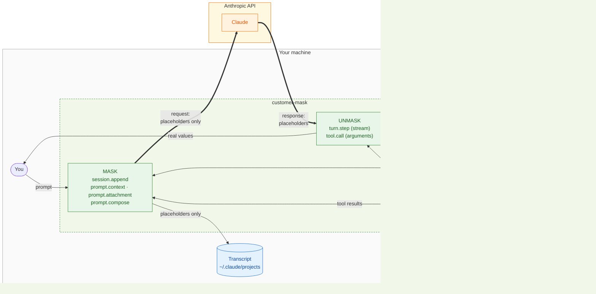
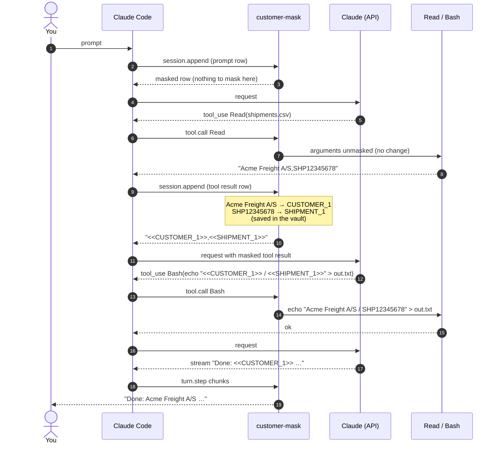
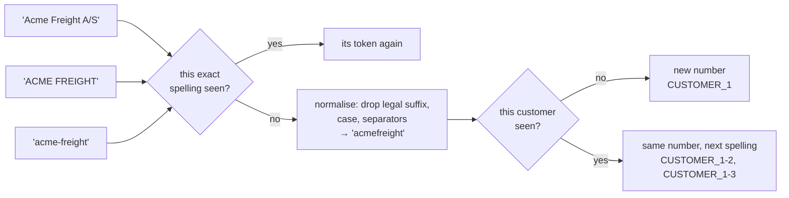
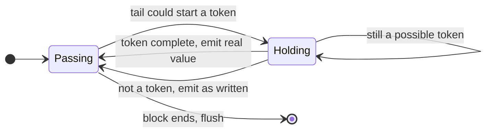
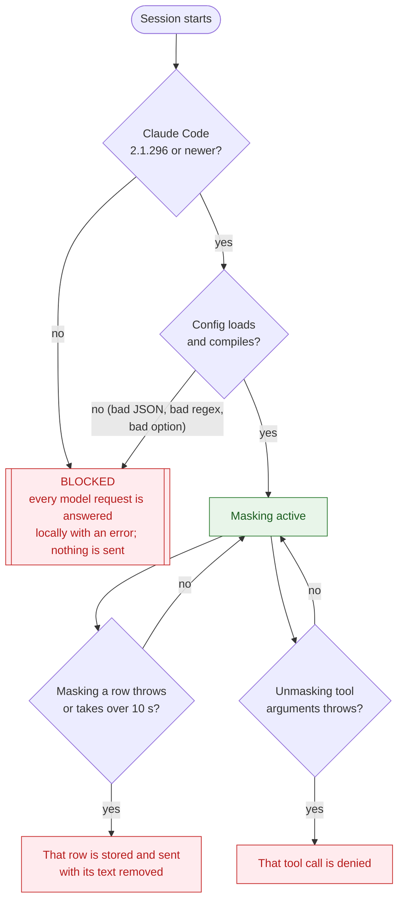

# How it works

customer-mask is a Claude Code **mod**: TypeScript functions that run inside the Claude Code process and hook the events Claude Code raises. It needs no proxy and no network setup. It sits in the path of every row that enters the conversation and every response that comes back.

- [1. The big picture](#1-the-big-picture)
- [2. One round trip, step by step](#2-one-round-trip-step-by-step)
- [3. The hooks](#3-the-hooks)
- [4. The placeholder vault](#4-the-placeholder-vault)
- [5. Detection](#5-detection)
- [6. Unmasking a stream](#6-unmasking-a-stream)
- [7. Failing closed](#7-failing-closed)
- [8. Why you still see real values](#8-why-you-still-see-real-values)

## 1. The big picture

Everything inside **Your machine** stays there. Only placeholders cross the thick arrows to the Anthropic API.



There are two directions:

- **Into the conversation (mask):** anything that becomes part of what Claude reads has real values swapped for placeholders. That includes your prompt, a file Claude read, command output, `CLAUDE.md` and the system prompt.
- **Out of the model (unmask):** placeholders in what Claude produces are swapped back. That covers the reply text streaming to your screen and the arguments of every tool call.

## 2. One round trip, step by step

You ask: *"Read shipments.csv and write the customer and shipment to out.txt"*. The file contains `Acme Freight A/S,SHP12345678,…`.



Steps 9 to 10 are where customer data first enters the conversation, and it is masked before step 11 sends it. Steps 13 to 14 are where Claude's placeholders become real again, just before your machine acts on them. Steps 18 to 19 do the same for the text you read. The model never sees a real value.

## 3. The hooks

All hooks are in [`hooks/register.ts`](../hooks/register.ts). The masking logic itself is a pure module, [`hooks/masker.ts`](../hooks/masker.ts), with no Claude Code dependency.

| Event | Direction | What it does |
| --- | --- | --- |
| `session.append` | mask | Fires once for **every row** a conversation stores: prompts, tool results, model responses, notices, subagent rows. Text blocks and `tool_result` contents are masked. Image and PDF blocks are removed, with a note in their place. What it returns is what is stored on disk **and** what the next request sends. |
| `prompt.context` | mask | Masks the context blocks of the first message (`CLAUDE.md`, etc.). |
| `prompt.attachment` | mask | Masks text Claude Code injects on its own (an `@file` mention, reminders). |
| `prompt.compose` | mask | Masks the per-session sections of the system prompt (git status, paths) and appends a note telling Claude how to use placeholders. Shared sections are left untouched so the cross-user prompt cache still hits. |
| `classic.UserPromptSubmit` | mask | Sets the session title from the masked prompt, so the stored title holds no customer data. |
| `turn.step` | unmask | Streams the model's response. Text and thinking chunks are unmasked on the fly for display. |
| `tool.call` | unmask | Restores real values in tool arguments before the permission prompt and the tool see them. `WebSearch`, `WebFetch` and every MCP tool keep their placeholders (configurable with `maskedTools` / `unmaskedTools`). Fails closed with a `.catch` that denies the call. |
| `session.end` | mask | When the session ends, masks the local copies Claude Code wrote into the transcript without passing them through the mod (prompt queue records, tool results' structured records), using the saved placeholder table. |
| `session.start` | – | Loads config, reserves placeholder numbers already in a resumed transcript, registers `/customer-mask`, sets the status line. |
| `command.run` | – | Answers `/customer-mask` with the config summary and the placeholder table. |

## 4. The placeholder vault

The vault is the two-way table between real values and placeholders.



- **Format:** `<<LABEL_n.mmmm>>`, e.g. `<<CUSTOMER_1.k3f9>>`. The double angle brackets are rare in real text and code, and survive Markdown, JSON and shell quoting. `mmmm` is a **random marker chosen once per session** (four lowercase letters or digits, kept across hot reloads). Only placeholders carrying this session's marker are ever restored, so text that merely looks like a placeholder (in a template, in code that handles placeholders, or from another session) is left exactly as written. The diagrams on this page leave the marker out for brevity.
- **One number per customer, one token per spelling:** `Acme Freight A/S`, `ACME FREIGHT` and `acme-freight` are all customer 1, written `CUSTOMER_1`, `CUSTOMER_1-2` and `CUSTOMER_1-3`. Claude can tell they are the same customer, and each is restored **exactly as it was written**. That matters for Claude's Edit tool, which must find the original text in the file. (Before 0.2, spellings differing only in case shared one token, so an edit could restore the wrong spelling and fail.) Phone numbers and IBANs treat separators the same way, and emails treat case the same way.
- **Stable:** the same spelling always gets the same placeholder within a session. Claude can reason across turns ("CUSTOMER_1 again"), and the prompt cache stays warm because earlier messages never change.
- **Idempotent:** text that already contains placeholders is never masked again.
- **Where it lives:** in memory (mirrored to the session's `$.state`, so it survives a hot reload of the mod), and in a file beside the session's transcript: `~/.claude/projects/<project>/<session-id>.customer-mask.json`. That file holds the marker and the real values in plain text. The transcript itself holds placeholders only. See [open questions #4](open-questions.md#4-vault-persistence-across-restarts) for the trade-offs.
- **Resumed sessions:** on start or resume, the mod reads that file and adopts its marker and entries, so every placeholder in the resumed conversation resolves again and numbering continues. It also reserves any placeholder numbers the conversation uses that the file lacks. `/clear` starts a new conversation with a new table.

## 5. Detection

Rules run in a fixed order, and the first rule to claim a span wins.

| Order | Label | Detects | Notes |
| --- | --- | --- | --- |
| 1 | `EMAIL` | `name@domain.tld` | First, so its parts are not taken by other rules |
| 2 | `IBAN` | `DK50 0040 0440 1162 43` and other countries | With or without spaces |
| 3 | `CPR` | `010190-1234` | Hyphenated only. A bare 10-digit run is too often a timestamp |
| 4 | *your labels* | your `patterns` regexes | e.g. `SHIPMENT`, `CUSTOMER_NO` |
| 5 | `CUSTOMER` | names from `customers` | Any case, with or without a legal suffix (`A/S`, `ApS`, `GmbH`, `Ltd`, …), any separator between words (space, hyphen, dot, none). Whole words only (`Lego` won't match `Legolas`). Longest name first. Two-letter suffixes such as `AS` or `Co` only count in that exact case, so *Acme as well* keeps its *as* |
| 6 | `PHONE` | `+45 12 34 56 78`, `12 34 56 78` | International, or Danish 2-2-2-2 grouping |

Detection is deliberately conservative. A false positive in code (masking a timestamp) changes what Claude sees, so the built-ins aim for precision. Recall for names comes from your list.

## 6. Unmasking a stream

The model streams its answer in small pieces, and a placeholder can be split across them:

```
"Shipment <<SHIP"   "MENT_1>> for <"   "<CUSTOMER_1>> is late."
```

`StreamUnmasker` holds back only a tail that could still become a placeholder (a trailing `<`, or `<<` followed by up to 64 token characters), and releases it once it completes or proves not to be one:



Each content block (text, thinking) is unmasked on its own, and any held tail is flushed when another kind of chunk arrives or the response ends. The text you watch therefore never shows half a placeholder, and nothing is held back longer than one token.

## 7. Failing closed

A mod hook that throws or runs out of time (10 s) is normally **skipped** by Claude Code, and for this mod a skipped hook would mean unmasked data goes out. So every failure path ends in a block or a removal:



When blocked, the status line shows `🔒 customer-mask: BLOCKED`, and `/customer-mask` says why. Fix the cause and restart the session. `/customer-mask` also counts rows removed because masking failed.

## 8. Why you still see real values

`session.append` rewrites a row before it is **stored and sent**. The screen, however, may show the row as it was just before that rewrite. This is documented Claude Code behaviour, and it is what makes the user experience work:

- Your own prompt stays readable on screen, while the model gets the masked copy.
- Tool output on screen (a file Claude read) shows real values, while the model gets the masked copy.
- Claude's reply is unmasked by `turn.step` as it streams, so you read real values. The stored copy is masked again by `session.append`.

The one place this breaks down is **headless** output: `claude -p` and the SDK return the *stored* final message, which is masked. Pipe it through `tools/unmask.mjs` to restore it (see [open questions #2](open-questions.md#2-headless-final-result-text-stays-masked)).
