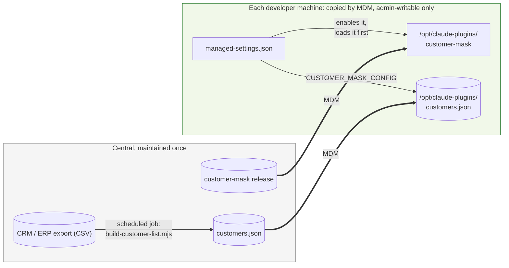

# Rolling out to a team

This guide makes customer-mask run for **everyone** in your organization: installed centrally, loaded before any mod a user installs, with one customer list maintained in one place. Users can't uninstall or disable it from inside Claude Code.

It uses Claude Code's managed settings, so you need whoever runs device management (MDM, Intune, Jamf, Ansible, …) for your developer machines. Every step below was tested with Claude Code 2.1.296.



## 1. Put the mod on every machine

Copy a release of this repository to the same path on every machine, for example:

| OS | Path |
| --- | --- |
| macOS / Linux | `/opt/claude-plugins/customer-mask` |
| Windows | `C:\ProgramData\claude-plugins\customer-mask` |

Make the folder, and every folder above it, **writable only by administrators**. Anyone who can write there can change what the mod does.

Claude Code only treats a mod as your organization's (loads it first, and keeps it loading under the strict policy) when it is installed **in place from a folder on the machine**. A plugin installed from GitHub with `/plugin install` counts as a user's mod, even when managed settings enable it. That's why the folder is copied by MDM rather than installed from GitHub.

## 2. Maintain one customer list

Export your customers from the CRM as CSV, then turn the export into the mod's format:

```bash
node tools/build-customer-list.mjs --csv accounts.csv --column "Account Name" \
     --hint-column "Industry" --patterns dsv-patterns.json \
     --out /opt/claude-plugins/customers.json
```

- `--column`: the column holding the customer name.
- `--hint-column` (optional): a column that describes a customer **without identifying it**, such as industry. It becomes the customer's [hint](configuration.md#hints).
- `--patterns` (optional): a JSON file whose `patterns` (shipment numbers, customer numbers, …) are copied into the output.

Comma-, semicolon- and tab-separated files are all accepted, as is Excel's UTF-8 CSV. Duplicate names are kept once. The script needs Node 22+ and runs locally.

Run it on a schedule (daily is usually enough) and distribute the output with MDM to the same path on every machine, again admin-writable only. For example, with cron:

```cron
15 6 * * *  /usr/bin/node /opt/claude-plugins/customer-mask/tools/build-customer-list.mjs --csv /srv/exports/accounts.csv --column "Account Name" --out /srv/dist/customers.json
```

Sessions read the list when they start, so a new customer is masked from the next session on. Users can still add their own project-specific names in `.claude/customer-mask.json`; both lists are combined.

## 3. Deploy managed settings

Managed settings live in a system folder and override everything a user sets:

| OS | File |
| --- | --- |
| macOS | `/Library/Application Support/ClaudeCode/managed-settings.json` |
| Linux and WSL | `/etc/claude-code/managed-settings.json` |
| Windows | `C:\Program Files\ClaudeCode\managed-settings.json` |

Start from [`rollout/managed-settings.json`](../rollout/managed-settings.json):

```json
{
  "extraKnownMarketplaces": {
    "customer-mask": {
      "source": { "source": "directory", "path": "/opt/claude-plugins/customer-mask" }
    }
  },
  "enabledPlugins": { "customer-mask@customer-mask": true },
  "prependPlugins": ["customer-mask@customer-mask", "sec-default@builtin"],
  "env": { "CUSTOMER_MASK_CONFIG": "/opt/claude-plugins/customers.json" }
}
```

| Key | What it does |
| --- | --- |
| `extraKnownMarketplaces` | Registers the folder from step 1 (this repository is its own marketplace). |
| `enabledPlugins` | Turns the mod on for everyone. Users can't turn a managed plugin off. |
| `prependPlugins` | Runs the mod **first**, ahead of any mod a user installs, so it sees every row before other mods and has the final say on what is sent. `sec-default@builtin` keeps Claude Code's built-in guard in the chain; leave it in. |
| `env` | Points every session at the central customer list from step 2. |

On Windows, write paths with doubled backslashes: `"C:\\ProgramData\\claude-plugins\\customer-mask"`.

### Stricter: only your organization's mods

[`rollout/managed-settings.strict.json`](../rollout/managed-settings.strict.json) adds two keys:

```json
"pluginConfigs": {
  "cc-plugin-sec-default@builtin": { "options": { "allowManagedModsOnly": true } }
},
"disableSideloadFlags": true
```

- `allowManagedModsOnly`: no mod a user installs or writes loads at all, so nothing can run beside customer-mask and undo its work. Users' settings hooks and status lines keep working.
- `disableSideloadFlags`: `--plugin-dir`, `--plugin-url`, `--agents` and `--mcp-config` are refused at startup.

## 4. Check it on a machine

```bash
claude --debug-file /tmp/cc.log -p "hello"
grep "customer-mask@customer-mask" /tmp/cc.log
```

You want to see `hooks module customer-mask@customer-mask loaded (…, tier prepend)`. If it says `tier user`, Claude Code doesn't treat the mod as your organization's: check that the folder path in `extraKnownMarketplaces` is absolute and correct, and that the mod was copied there rather than installed from GitHub.

In an interactive session, the status line shows `🔒 customer-mask on`, and `/customer-mask` lists the config it loaded (it should name the central `customers.json`).

**What was verified** (Claude Code 2.1.296, in an isolated test with real managed settings):

| Check | Result |
| --- | --- |
| Mod loaded with no `--plugin-dir` | `tier prepend` ✅ |
| Customer only in the central list | masked; no raw copy in the transcript ✅ |
| That customer's hint | used by Claude in its answer ✅ |
| Strict variant, `claude --plugin-dir …` | refused by policy ✅ |
| Strict variant, normal run | mod still loads first ✅ |

## What users can still do

Be clear about the limits before you rely on this:

- **`claude --safe-mode` and `claude --bare` start Claude Code without any plugins, this one included.** In 2.1.296 no managed setting blocks these flags. A user who deliberately starts that way sends unmasked data. Cover this with policy and training, or add a network-level control (e.g. route Claude traffic through a gateway you operate).
- **Data a pattern or the list doesn't cover is not masked.** See [open questions #5](open-questions.md#5-recall-customers-not-in-the-list).
- **Headless session titles** are generated from the raw first prompt ([#1](open-questions.md#1-headless-session-title-is-generated-from-the-raw-prompt)).
- `disableAllHooks: true` in managed settings turns this mod off too. Don't set it.

## Updating

Copy the new release over the folder from step 1 (MDM). Sessions pick it up when they start; a running session can run `/reload-plugins`. Check the minimum Claude Code version in the release notes: the mod blocks requests on anything older than the version it was tested on.
